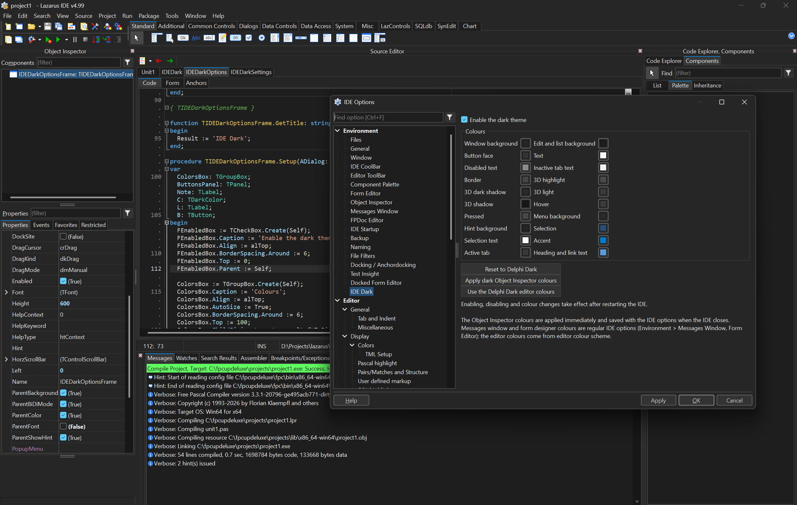

# Dark theme for Lazarus
> This package is design-time only.
> The purpose is just to have a friendly Dark mode for Lazarus IDE.

Built and tested for/in Windows 11. Although, it might work on Windows 10 as well.



### The package includes "Delphi Dark" editor scheme (bundled and installed automatically).
It's also available here in a separate file `DelphiDark.xml`.

For Messages window, and Form editor use the following (merge to the current `C:\fpcupdeluxe\config_lazarus\environmentoptions.xml` on FPC Deluxe):
```xml
  <EnvironmentOptions>
    <FormEditor GridColor="5263440">
      <GrabberColor Value="13948116"/>
      <MarkerColor Value="8421504"/>
      <NonFormBackgroundColor Value="1973790"/>
      <Rubberband>
        <SelectionColor Value="14064726"/>
        <CreationColor Value="8110309"/>
      </Rubberband>
    </FormEditor>
    <MsgView>
      <Colors Background="1973790" Running="16717" Success="2837790" Failed="1973850" TextColor="13948116"/>
    </MsgView>
  </EnvironmentOptions>
```

Or edit manually in IDE Options -> Environment -> Messages Window